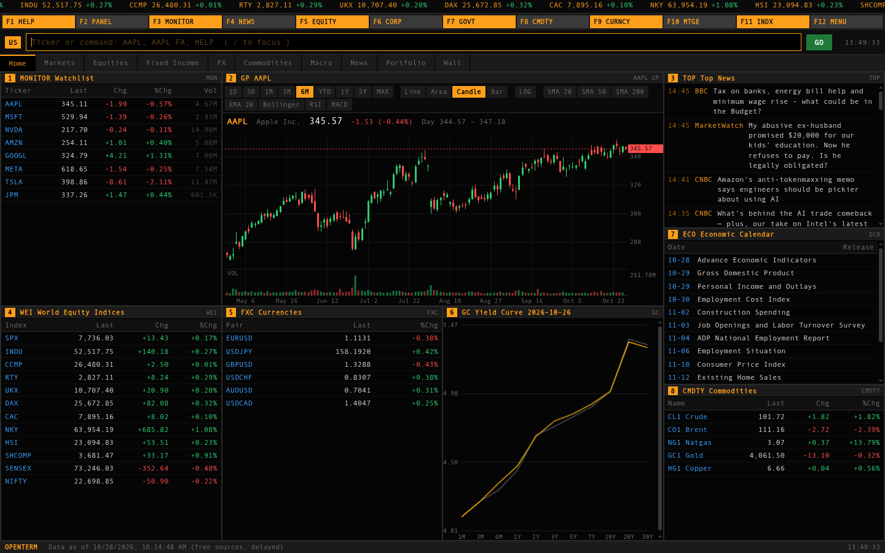
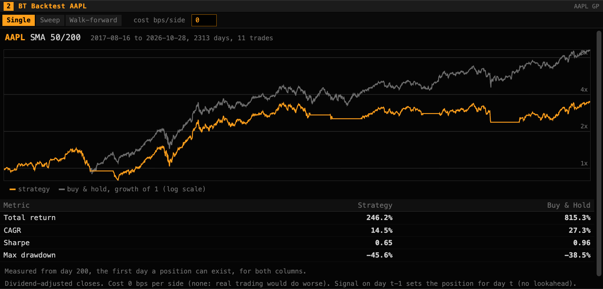
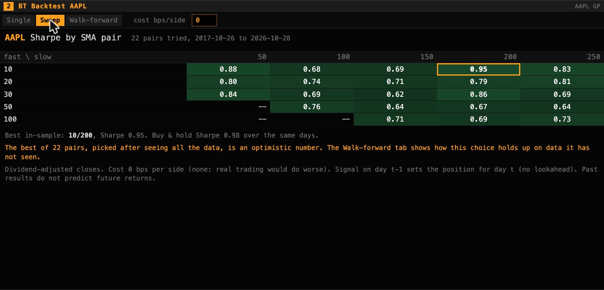
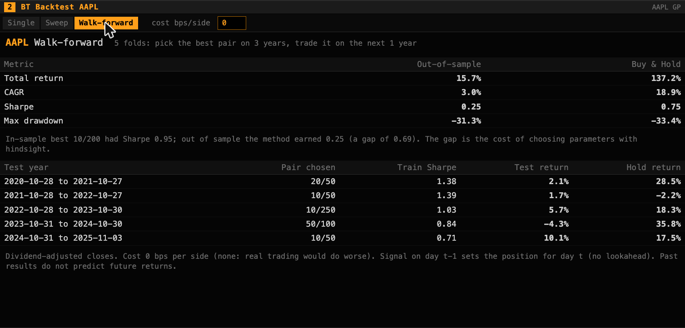

# OpenTerm


[](https://openterm-lovat.vercel.app)

**[Live demo](https://openterm-lovat.vercel.app)**

An open-source, Bloomberg-style market terminal built only on free data sources.

## Run

```bash
npm start
```

Then open http://localhost:3200. No dependencies, Node 20.12+ (`process.loadEnvFile` reads `.env`).

Without Upstash env vars, data is kept in a local file store (`cache/store.json`). Fill it with `npm run seed`, which forces every group to run. If `.env` has Upstash credentials, that writes to Upstash instead. `.env.example` lists the variables.

## What works now

- Command bar (`AAPL`, `CHART TSLA`, `NEWS NVDA`)
- Watchlist with live (delayed) quotes
- Price chart
- Headlines per symbol
- Live market news wire (`WIRE` or `WIRE <ticker>`), auto-refreshing every 45s, pauses on hover
- Earnings-call coverage headlines on `ERN` (no free full-transcript source exists, so this is press writeups, not the call itself)
- US Congress, Trump and cabinet stock trades (`CONG`, `POL`)
- Day-count convention math (`/api/daycount`)
- Backtest lab (`AAPL BT 50 200`): moving-average crossover vs buy & hold, a 22-pair parameter sweep, and a walk-forward test. See [Backtest lab](#backtest-lab-bt) below
- Total crypto market cap and BTC/ETH dominance in the `CRYPTO` widget header
- `ECB` widget: euro-area reference rate chart + majors strip (USD, GBP, JPY, CHF, CNY, AUD, CAD)

## Backtest lab (BT)

`AAPL BT 50 200` runs a moving-average crossover (long when the 50-day average is above the 200-day, cash otherwise) on 10 years of daily, dividend-adjusted closes and compares it with buy and hold. The point is not to find a strategy that wins. It is to show, with numbers, the ways a backtest can mislead.

| Single run | Parameter sweep | Walk-forward |
|---|---|---|
|  |  |  |

*Screenshots are from live data on 2026-10-28, so their numbers differ slightly from the stored-data table below.*

**Three tabs:**

- **Single:** one pair, with total return, CAGR, Sharpe and max drawdown next to buy and hold, and equity curves on a log scale.
- **Sweep:** Sharpe for every fast/slow pair (fast 10 to 100, slow 50 to 250, 22 pairs), all scored on the same days so they are comparable. The best cell is outlined, with a warning that it was chosen after seeing the data.
- **Walk-forward:** choose the best pair on 3 years, trade it on the next unseen year, roll forward, and stitch the test years together. This is the honest number.

A cost box (basis points per side, default 0) applies to every tab.

### Results on stored data

<!-- bt-report:start -->
Stored daily closes, 2026-10-27 back 10 years, no costs. Regenerate with `node scripts/bt-report.mjs --write`.

| Ticker | 50/200 Sharpe (CAGR) | Buy & hold Sharpe (CAGR) | Best of 22 pairs, full period | Walk-forward out-of-sample Sharpe (CAGR) | Best pair in hindsight, same days | Buy & hold, same days |
|---|---|---|---|---|---|---|
| AAPL | 0.65 (14.6%) | 0.96 (27.4%) | 10/200: 0.95 | 0.25 (3.0%) | 10/200: 0.74 | 0.75 (18.9%) |
| SPY | 0.70 (10.3%) | 0.84 (15.0%) | 10/100: 1.00 | 0.94 (12.5%) | 20/200: 1.33 | 0.98 (16.7%) |
| VFC | 0.05 (-2.7%) | 0.01 (-10.2%) | 20/200: 0.32 | 0.01 (-2.5%) | 20/200: 0.22 | -0.30 (-25.4%) |
<!-- bt-report:end -->

What the table says:

- **AAPL:** over the walk-forward test years, the best single pair picked with hindsight scores a Sharpe of 0.74, but choosing pairs the same way without hindsight earned 0.25. That gap is the cost of not knowing the future, and it is what overfitting looks like. Buy and hold beat every version.
- **SPY:** out of sample the rule roughly matched the index on risk-adjusted terms (0.94 against 0.98) but earned less, while hindsight would have promised 1.33.
- **VFC** (down about 55% over the decade): the trend filter cut the damage, losing 2.5% a year out of sample against 25.4% for holding.

### Method

- The signal from close t-1 sets the position for day t. A test proves it: replacing every price from day t onward never changes a position up to day t, and a deliberately peeking variant is caught.
- Stats start on the first day a position can exist, for both columns, so the warmup period does not dilute them.
- Sharpe uses a 0% risk-free rate and 252 trading days.
- Walk-forward folds never overlap, and the pair picked for each fold provably does not depend on any price in its test year. The stitched out-of-sample series starts flat, and switching pairs between folds is charged as a trade.

### Limits

- No taxes, borrowing, or position sizing. Costs are 0 unless you set them.
- Five walk-forward folds is a small sample.
- Picking tickers is itself a bias. Survivorship is real: Walgreens (WBA) now returns a 404 from Yahoo after going private, so a backtest run today cannot even include it.
- Yahoo is a free, unofficial source.

### Verify it yourself

```bash
node scripts/test-backtest.mjs          # hand-computed values, lookahead and leakage tests
node scripts/bt-report.mjs --check      # README table matches the stored fixtures

# exact match against the original Python backtester (ma67-ex/stock-backtester), one-time setup:
python3 -m venv scripts/.venv && scripts/.venv/bin/pip install pandas numpy
scripts/.venv/bin/python scripts/crosscheck.py
```

`crosscheck.py` expects the `stock-backtester` repo next to this one. Fixtures are refreshed with `node scripts/fetch-fixture.mjs AAPL SPY VFC`.

## Roadmap (feature parity target, free sources only)

| Bloomberg area | Free source |
|---|---|
| Equities, ETFs, indices, FX, futures | Yahoo chart endpoint, Stooq\*, Twelve Data |
| Filings and fundamentals | SEC EDGAR, Financial Modeling Prep free tier |
| Macro and economics | FRED, World Bank, IMF, ECB\*\* |
| Crypto | CoinGecko\*\*, Binance public API\*\*\* |
| News | RSS, GDELT, Finnhub |
| Screener, heatmaps, movers | Computed from quotes |
| Yield curves, rates | FRED, US Treasury |
| Earnings and economic calendar | Finnhub, FRED releases |
| Portfolio and risk analytics | Computed locally |

## Known limits

Free feeds are delayed or rate-limited. Real-time ticks, dealer-quoted fixed income, licensed analyst consensus and chat are out of scope. Check each provider's terms before redistributing data publicly.

\* Stooq's `/q/d/l/` and `/q/l/` endpoints now serve a JS proof-of-work challenge page instead of CSV for plain server-side requests (verified directly, 2026-10-15) — no key, no CAPTCHA, just a bot check a headless fetch can't pass. Dead as a server-side source until that changes.

\*\* CoinGecko is wired via `CRYPTO` (seeded top-30 + live global dominance) and `/api/crypto`. ECB is wired via the `ECB` widget and `/api/ecb` (majors reference rates only, not the full dataflow catalog).

\*\*\* Binance's public REST API geo-blocks by request IP per their own terms (`"Service unavailable from a restricted location"`, verified directly, 2026-10-15) — unreliable from US-region hosts. The global exchange is not used. If Yahoo cannot price a crypto pair such as BTC-USD, quotes fall back to Kraken, then to Binance.US (the US exchange), neither of which needs a key. The yield curve falls back from FRED to the US Treasury, which needs no key either. See `docs/DATA_SOURCES.md` for every source checked and what its terms allow.

## License

MIT. See [LICENSE](LICENSE).
